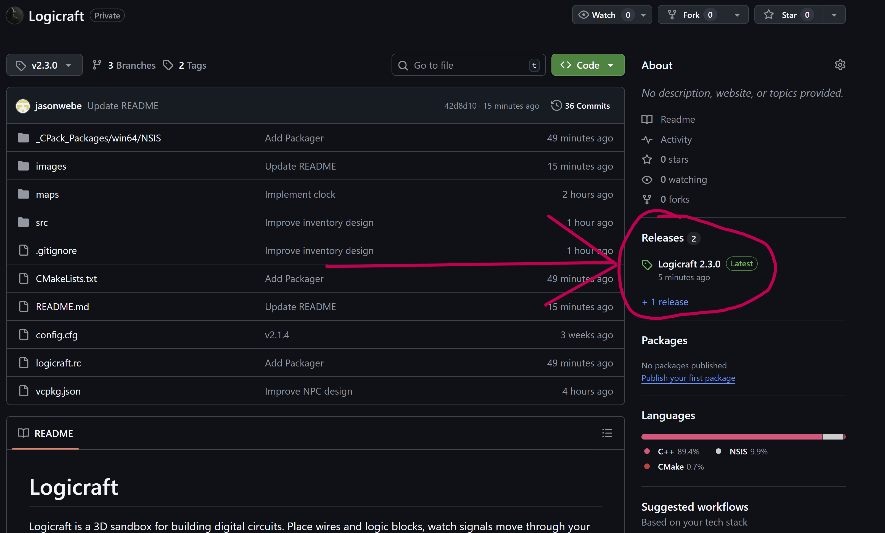

<p align="center">
  
</p>

<h1 align="center">Logicraft</h1>

<p align="center">
  <strong>Construisez vos circuits. Donnez vie à vos idées.</strong><br>
  Un bac à sable 3D où l’électronique devient un terrain de jeu.
</p>

<p align="center">
  <a href="#installation">Jouer</a> ·
  <a href="#ce-que-vous-pouvez-créer">Créer</a> ·
  <a href="#contribuer">Contribuer</a>
</p>


## Imaginez. Construisez. Testez.

Logicraft est un jeu de construction 3D dédié aux circuits numériques. Assemblez des portes logiques, faites circuler les signaux et transformez vos idées en machines fonctionnelles — le tout dans un monde que vous pouvez façonner bloc par bloc.

Que vous souhaitiez comprendre les bases de la logique numérique ou concevoir des systèmes ambitieux, Logicraft vous donne les briques pour expérimenter librement, observer instantanément le résultat et apprendre en construisant.

## Pourquoi Logicraft ?

- **Une électronique concrète** : voyez les signaux se propager et comprenez chaque étape du circuit.
- **Une liberté de construction** : mélangez architecture, décoration et logique pour créer des machines lisibles et originales.
- **Un terrain d’expérimentation** : testez, modifiez et recommencez sans limite.
- **Des exemples prêts à explorer** : découvrez la carte `maps/syslog.bulldog`, avec plusieurs circuits et un compteur à 7 segments.

## Ce que vous pouvez créer

- Compteurs, horloges et minuteries
- Additionneurs, décodeurs et multiplexeurs
- Circuits combinatoires et séquentiels
- Afficheurs LED et écrans 7 segments
- Gadgets interactifs et machines entièrement personnalisées

## Les blocs logiques


- Fils, bouton, LED et panneau
- AND, OR, NOT et XOR
- Bascule D
- Additionneur
- Séparateur et fusionneur
- Décodeur et multiplexeur
- Comparateur
- Horloge

## Les blocs du monde

Herbe, terre, pierre, bois, feuilles, eau, planches, sable et verre : construisez un environnement à la hauteur de vos circuits.

## Installation

### Joueurs — Windows 64 bits

1. Téléchargez l’installateur Windows depuis la page [GitHub Releases](https://github.com/Jzn-wbr/messercraft/releases).
2. Lancez `Logicraft-...-win64.exe`.
3. Démarrez le jeu depuis le menu Démarrer ou le raccourci du bureau.

Vous n’avez besoin que du fichier `.exe`.



## Commandes

| Action | Touche |
| --- | --- |
| Regarder autour de soi | Souris |
| Se déplacer | `W/A/S/D` (Auto accepte aussi `Z` pour avancer) ou `Z/Q/S/D` avec le profil AZERTY |
| Sauter | `Espace` — deux appuis pour voler |
| Sprinter | Deux appuis sur Avancer, ou `Alt` |
| S’accroupir au sol / descendre en vol | `Maj` |
| Casser ou poser plusieurs blocs | Maintenir le clic gauche ou droit |
| Actionner un bouton ou modifier un panneau | Clic droit, `Maj` + clic droit pour poser à côté |
| Sélectionner le bloc visé / copier ses réglages | Clic molette / `Ctrl` + clic molette |
| Changer de case rapide | Molette |
| Sélectionner une case | `1` à `9` |
| Ouvrir l’inventaire / afficher la palette créative | `E` / `Tab` dans l’inventaire |
| Ouvrir les réglages du bloc visé | `Q` par défaut, `F` si `Q` sert à aller à gauche |
| Orienter un composant avant la pose / tourner le bloc visé | `T` / `Maj` + `T` |
| Annuler / rétablir une modification | `Ctrl` + `Z` / `Ctrl` + `Y` |
| Revenir au point de départ | `R` |
| Sélectionner deux coins / copier / afficher l’aperçu | `Ctrl` + `B` deux fois / `Ctrl` + `C` / `Ctrl` + `V` |
| Tourner le groupe / confirmer le collage | `T` / `Entrée` |
| Charger / sauvegarder un circuit réutilisable | `F3` / `F4` |
| Poser ou retirer une sonde sur le bloc visé | `F9` |
| Plein écran | `F11` |
| Menu pause / fermer une fenêtre | `Échap` |

Les réglages proposent des profils clavier et des raccourcis modifiables pour les déplacements, l’inventaire, la configuration des blocs, la rotation et le retour au départ.

La simulation vise une cadence fixe de vingt mises à jour par seconde. Les câbles sangria ont un brin par bit de largeur, y compris quand la valeur est zéro. L’inspecteur de bus affiche la largeur et la valeur du signal en direct.

En jeu, le clic gauche manipule une pile et le clic droit en prend la moitié ou dépose une unité. Le glissement répartit la pile, le double clic rassemble les objets identiques, et `Maj` transfère une pile vers l’autre zone ou toutes les piles identiques avec un double clic. Survole une case et appuie sur `1` à `9` pour l’échanger avec ce raccourci. Dans la palette créative, tape pour filtrer, appuie sur `Entrée` pour changer de catégorie et utilise le clic molette pour marquer un favori.

## Cartes et sauvegardes

Utilisez **Cartes** à l’accueil, **SAVE / LOAD** dans le menu pause ou `Ctrl` + `O` pour ouvrir le gestionnaire. Le gestionnaire donne aussi accès au tutoriel bouton–fil–LED.

- **Enregistrer** ou `Ctrl` + `S` enregistre la carte active. **Enregistrer sous** dans le gestionnaire ou `Ctrl` + `Maj` + `S` permet de choisir un autre nom.
- **Écraser** demande une confirmation dans le jeu. Charger une carte ou quitter avec des modifications propose **Annuler**, **Sans enregistrer** ou **Enregistrer**.
- **Reprendre** ouvre la sauvegarde la plus récente. Jusqu’à trois versions automatiques figurent dans la liste sous un nom commençant par `recuperation-`.
- Le fichier compagnon `.bulldog.hotbar` contient les raccourcis et favoris de la carte. Gardez-le avec le fichier `.bulldog` lors d’une copie manuelle.

Les anciennes cartes restent lisibles. Les cartes avec des composants tournés utilisent le format v12. Il reprend l’en-tête et la table des panneaux du format v11, avec un dixième octet par cellule pour le nombre de quarts de tour horizontaux, de 0 à 3. Les autres cartes sont toujours écrites en v11.

---

## Contribuer

Vous souhaitez améliorer Logicraft, ajouter des blocs ou proposer une nouvelle idée ? Les contributions sont les bienvenues. Ouvrez une issue pour partager votre proposition ou une pull request pour soumettre directement une amélioration.

### Compiler depuis les sources — Windows

Prérequis :

- CMake 3.21+
- vcpkg (par exemple `C:\\vcpkg`)
- Visual Studio Build Tools 2022 (`cl.exe`)

Configurer et compiler dans PowerShell :

```powershell
cmake -B build -S . -G "Visual Studio 17 2022" -A x64 `
  -DCMAKE_TOOLCHAIN_FILE="C:/vcpkg/scripts/buildsystems/vcpkg.cmake" `
  -DVCPKG_TARGET_TRIPLET=x64-windows

cmake --build build --config Release
```

Lancer le jeu :

```powershell
.\build\Release\logicraft.exe
```

### Créer l’installateur

NSIS est nécessaire pour générer l’installateur avec CPack.

```powershell
cmake -S . -B build
cmake --build build --config Release
cpack -C Release --config build\CPackConfig.cmake
```

L’installateur sera créé dans `build`.

## Structure du projet

- `src/` : code C++
- `images/` : textures et visuels
- `maps/` : cartes sauvegardées (`.bulldog`)
- `config.cfg` : configuration utilisateur
- `CMakeLists.txt` et `vcpkg.json` : compilation et dépendances
- `build/` : fichiers générés par CMake (ignorés par Git)

## Notes techniques

SDL2 et GLEW sont liés dynamiquement par défaut. Leurs DLL sont copiées à côté de l’exécutable afin que le jeu fonctionne sans configuration supplémentaire.

Pour désactiver la copie des DLL, utilisez `-DVCPKG_APPLOCAL_DEPS=OFF` et ajoutez `C:\\vcpkg\\installed\\x64-windows\\bin` au `PATH`, ou choisissez le triplet statique `x64-windows-static`.
